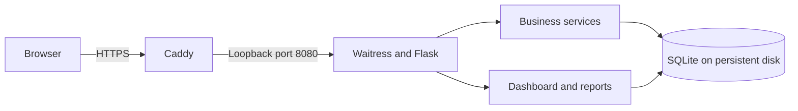

# DCMS architecture

Verified against the application and hosted configuration on 10 November 2026. This describes the implemented web application; the desktop section describes planned work.

## Current system

DCMS is a custom Python application built around Deniz Construction's daytime sales and evening reconciliation workflows. Flask renders HTML using Jinja templates, with repository-local CSS and JavaScript. Waitress serves the application. SQLite stores records on persistent disk. ERPNext informed the interface review; DCMS does not run on Frappe or ERPNext.

For local development the browser connects directly to Waitress over HTTP. The hosted browser needs access to the server. Running the web application locally does not establish delivery of the standalone offline application.

## Code responsibilities

| Component | Responsibility |
|---|---|
| `dcms/__main__.py` | Database initialization, sample seeding, VAT command and Waitress startup |
| `dcms/web.py` | Main routes, request validation, CSRF, navigation and page rendering |
| `dcms/auth.py` | Account-file loading, sessions, login throttling and role enforcement |
| `dcms/services.py` | Sales, stock deduction, expenses, business dates, closing, workers and attendance rules |
| `dcms/modules.py` | Worker, tax and bank screens |
| `dcms/banking.py` | Statement import, matching, reversal history and retry handling |
| `dcms/analytics.py` | Dashboard reporting over saved records |
| `dcms/db.py`, `dcms/migrations/` | Connections, immediate write transactions and numbered SQL migrations |
| `dcms/demo.py` | Small worked example and five-month synthetic history |
| `dcms/templates/`, `dcms/static/` | Shared layout, pages, forms, styles, browser interactions and print presentation |
| `tests/` | Business-rule, concurrency and HTTP regression coverage |

## Persistent records

The actual schema is defined by the numbered files in `dcms/migrations/`, rather than the proposed database design in the coursework document. The current SQLite application enforces business workflows through Python services and database constraints; the coursework's proposed stored procedures, SQL roles and triggers are not deployed here.

- `products`, `settings` and effective-dated `vat_rates` hold the catalogue and configuration.
- `business_days` scopes transactions and opening cash; `non_operating_days` records explicit calendar exceptions.
- `sales` and `sale_lines` retain posted receipt values. `expenses` stores individual cash outflows.
- `daily_closes` stores the financial and attendance snapshot of a closed date.
- `workers`, `worker_rates`, `attendance` and `attendance_changes` support dated eligibility and correction history.
- Bank accounts, sale/account links, imported transactions, matches, allocation events and operation request records support statement review.
- `demo_metadata` identifies synthetic dataset context. It is not operational transaction history.

Money uses integer minor units. Foreign keys are enabled on each connection. Schema version is recorded in SQLite `user_version`; startup applies unapplied migrations. A database from a newer schema version is rejected by older application code.

## Transaction boundaries

**Sale:** Validate an open business date, active products, positive whole quantities, catalogue prices, VAT and exact full payment. One payment channel is recorded per sale: Cash, Mobile Money or Bank Deposit. Save the sale, lines and stock deductions in one transaction. An oversold line rolls back the entire sale. Identical submission retries return the saved receipt; conflicting reuse of the request key is rejected. Printing happens after commit, so a failed print can be retried from the saved receipt.

**Close:** Compute expected cash as opening cash plus cash sales minus cash expenses. Variance is physical cash counted minus expected cash. Any nonzero variance requires an explanation. Recompute and save the snapshot and closed status together, checking the preview revision. A repeated close returns the saved report. Financial and attendance postings to a closed date are rejected. Values belong to business dates; there is no mutable global drawer that must be reset to zero each evening.

**Concurrency:** Writes use `BEGIN IMMEDIATE` and a three-second SQLite connection timeout. This serializes competing writers, including sales against the last stock and sales competing with closure. This is a single-instance design; it has no distributed write coordination or database replication.

**Attendance and banking:** Attendance determines wage eligibility, not proof of payment. Actual wage cash outflow must also be recorded as an expense. Bank matching verifies recorded bank activity against imported statements; it does not create another sale or change an already-saved daily close. Reversal events preserve allocation history.

## Access and trust boundaries

The hosted deployment loads Sales Manager and CEO accounts from a file outside Git. Passwords are salted PBKDF2 hashes. The Sales Manager can perform operations; CEO access is read-only and enforced on the server. Sessions last eight hours, use HTTP-only cookies and use secure cookies on HTTPS. Login, logout and modifying forms have CSRF protection. The single-process login limiter allows five attempts per client IP per minute.

Caddy terminates TLS and forwards to Waitress on `127.0.0.1:8080`. Waitress trusts forwarding headers only from the configured loopback proxy. The application runs as the unprivileged `dcms` account, with writable persistent storage separated from code and credentials. Runtime secrets and account hashes are not included in the repository or screenshots.

Read-only CEO access does not imply field-level confidentiality between roles. General per-operation actor attribution and a complete immutable financial audit trail remain future work.

## Deployment and lifecycle

The approximately 1 GB VM runs one systemd-managed application process and Caddy. The application service has a 256 MiB memory limit; this is a configured ceiling, not a measured capacity guarantee. There is no Docker, PM2, Node application runtime or separate database server. Swap was not changed.

Code resides in `/opt/dcms`, data in `/var/lib/dcms`, and configuration in `/etc`. Updating code and restarting the service preserves data. Startup can migrate the database, so updates require a consistent backup and a recovery plan. Stopping the service preserves its database; stopping the site does not deallocate the VM.

See [local operation](RUNNING.md) and [server deployment and recovery](DEPLOYMENT.md) for exact commands.

## Planned standalone application

The existing implementation plan proposes a PySide6 interface around reusable Python business services, with an independent SQLite database in the OS user-data directory. PySide6 is not currently an application dependency and no desktop UI or installer is delivered. Windows `.exe` installation and Debian `.deb` packaging require target-platform builds and clean-machine acceptance tests.

The standalone acceptance gate includes launching without internet or a separate Python installation, posting sales, physical receipt printing, closing, restarting, upgrading without data loss, and tested backup/restore. Native printing, supported platforms, deployment tooling and distribution arrangements still need validation. Hosted and desktop databases are separate; synchronization and conflict resolution are not implemented.

## Current limits

- Tax screens summarize recorded sales VAT; they do not calculate complete tax liability, input VAT or payroll taxes, and are not integrated with EFRIS.
- Bank integration is CSV import and matching, without live bank feeds or transfers.
- Sales voids/refunds, a complete production/damage/return stock ledger and reorder alerts remain pending.
- Automated off-machine backup, restore tooling, full financial actor audit and desktop distribution remain pending.
- Historical records and screenshots are synthetic. Physical printer acceptance, production workload capacity and business usability acceptance remain unverified.

See the [implementation plan](IMPLEMENTATION_PLAN.md) for remaining work and the [status record](IMPLEMENTATION_STATUS.md) for delivered changes and verification history.
