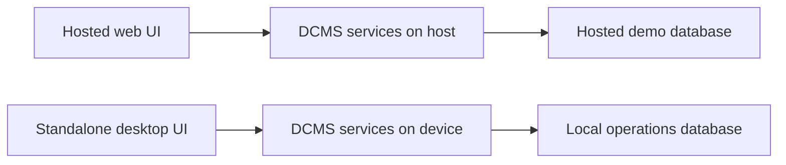

# DCMS implementation plan

## Release goals

1. **Hosted web prototype for the 10 November presentation.** Demonstrate a paid sale, stock deduction, a printable receipt and a saved Close of Day report using sample data. Capture the working Close of Day screen for slide 7.
2. **Standalone desktop application for offline use.** Install and run DCMS on a computer with no internet connection. The application owns its interface, local database and printing workflow. Initial distribution targets are a Windows installer `.exe` and a Debian-compatible `.deb`. Confirm the supported OS versions and CPU architectures before building release packages.

Treat these as separate release gates. The hosted prototype demonstrates the workflow. The desktop package demonstrates the offline requirement on installed software. Keep the presentation screenshot available if the hosted demo loses connectivity.

## Sources and decisions

- The [master specification](build/specs/spec_master.json) defines the proposed behavior and verification cases. The [Phase 1 source](build/specs/spec_doc01.json) and [curated data](CURATED_DATA.md) distinguish field findings from assumptions. The [SOP](build/specs/spec_sop.json) supplies operator terminology, and the [presentation spec](build/specs/spec_presentation_pptx.json) supplies the slide 7 scenario.
- Deniz accepts payment upfront through Cash, Mobile Money or Bank Deposit. The prototype records the selected channel and the operator's confirmation of full payment. Mobile Money and bank figures represent recorded activity. External statement matching remains outside the current specification.
- Use sample catalogue prices, stock, customer names and payment references. Seed the demo VAT rate at 18 percent through settings. Record the applied rate per sale. The actual receipt fields, VAT basis and filing treatment, stocking units, printer model and opening float practice require confirmation before a pilot.
- Use SQLite for the initial implementation. The project has no fixed MySQL requirement. Implement the atomic behavior from the SRS through the shared application services and SQLite transactions. Revisit the hosted database only if its deployment topology or workload requires it.
- Build DCMS directly. The chosen scope is two connected workflows. The ERPNext evaluation remains reference material.

## Application architecture

| Layer | Web prototype | Standalone desktop |
|---|---|---|
| Interface | Flask and server-rendered HTML with local CSS and JavaScript | PySide6 desktop screens for Daily Sales, Close of Day, receipts and report history |
| Business rules | Shared Python services for posting, stock, VAT, expenses and closing | The same services, called directly by the desktop UI |
| Data | SQLite on persistent storage on one hosted instance | A separate SQLite database in the OS user data directory selected through Qt |
| Printing | Print-ready HTML and the browser print dialog after a sale commits | Native print preview and print dialog through the operating system |
| Start and access | A URL with HTTPS and restricted access to the sample-data demo | An installed program launched from the desktop or application menu |

Keep calculation and transaction code independent of Flask request objects and Qt widgets. Test it through both interfaces as they become available. Each deployment owns its data. If live data ever needs to move between them, decide which database is authoritative and define an explicit migration or synchronization workflow before enabling shared use. The demo database contains sample data and has no role in the desktop installation. [Qt standard data paths](https://doc.qt.io/qtforpython-6/PySide6/QtCore/QStandardPaths.html)

## Schema and transaction rules

| Record | Required data and constraints |
|---|---|
| Products and settings | Unique SKU, description, stock unit, selling price, available quantity and active status. Configurable VAT rate. Seed whole-unit products for the demo. |
| Business day | Unique business date, open or closed status, opening cash and a revision for changes affecting the close preview. Display dates in the site's Kampala time context. |
| Sale and sale lines | Date, timestamp, receipt number, customer name, payment channel, confirmed payment amount and optional applicable reference. Store quantities, unit prices, descriptions, applied VAT rate and totals as posted. Enforce a unique submission key and unique receipt number. |
| Cash expense | Business date, amount greater than zero, description and timestamp. One row per cash outflow. |
| Daily close | One immutable application-level snapshot per business date. Store opening cash, channel totals, expenses, expected and actual cash, signed variance, explanation and time closed. |

Store currency as integer minor units. For the demo, calculate VAT on the invoice subtotal and round once to the nearest minor unit with ties rounded up. Confirm this rounding and tax basis before using live data. Use foreign keys, unique constraints and quantity and amount checks. Enable foreign keys on each connection. Make schema changes through numbered migrations and keep test and demo databases separate from operational data. [SQLite foreign keys](https://www.sqlite.org/foreignkeys.html)

### Daily Sales

1. Validate the open business date, active products, positive quantities and selected payment channel on the server. Fetch prices from the catalogue and compute subtotal, VAT and total on the server.
2. Record full payment under one channel. For the first release, use the exact amount allocated to the sale and omit cash tender and change calculations. Include fields for the Mobile Money transaction reference or bank deposit slip where applicable.
3. Start a write transaction and check whether this submission key has already posted. An identical retry returns the existing receipt. Reusing the key for different sale details returns an error.
4. Check the day is open, combine stock demand for repeated product lines and deduct stock only where enough remains. Save the header, lines, stock changes and receipt number together. Roll back all changes if any line fails.
5. After commit, display the saved receipt and allow reprinting. A print failure leaves the posted sale available for reprint.

### Close of Day

1. Select an open business date, show recorded totals for Cash, Mobile Money and Bank Deposit, and allow cash expense entries and an opening float. Default opening cash to zero.
2. Calculate expected cash as **opening cash + net recorded cash activity − cash expenses**. In the initial release, net cash activity is the sum of posted cash sales. Add eligible voids and actual refunds when the adjustment workflow is implemented.
3. Require an actual physical count of zero or more. Calculate **variance = actual cash − expected cash**. A negative amount is a deficit. Trim the explanation and require it when variance is nonzero.
4. Start the same kind of write transaction used for postings. If the day is already closed, return its snapshot. Otherwise check the preview revision, recompute totals, save the snapshot and mark the day closed together. If the revision changed, ask the operator to review the new totals. All subsequent financial changes to that date must pass through the same open-day check.
5. Read the saved report from the snapshot. Show blocks sold from actual sale lines if included. Add truck and worker counts when there are records that support them.

Use SQLite immediate write transactions to serialize competing writes. Handle a busy database with a bounded wait and a clear retry message. The receipt and close retry rules prevent duplicate writes after an uncertain response. [SQLite transaction behavior](https://www.sqlite.org/lang_transaction.html)

## Build sequence

| Step | Work | Exit check |
|---|---|---|
| 1. Foundation | Set up the Python project, pin dependencies, create migrations and seed a repeatable sample dataset. Add a launch command and a test command. | A fresh database starts with the intended catalogue and sample business dates. |
| 2. Reconciliation first | Implement business dates, cash expenses, expected cash, variance and the transactional close. Build the web screen and saved report. | The UGX 5,000 deficit example closes and reopens with the same report. |
| 3. Connect Daily Sales | Add the cart, payment confirmation, stock checks, saved receipt and print view. Feed posted sales into reconciliation. | A real sale changes only the selected date and channel. An oversell rolls back the whole transaction. |
| 4. Host and rehearse | Use a production WSGI server, HTTPS and access restrictions. Keep SQLite on persistent storage with a single hosted instance. Use sample data. | A second device can open the hosted demo. A service restart preserves the sample sale and close. Capture slide 7 from the running app and rehearse with the screenshot available. |
| 5. Standalone desktop | Build PySide6 screens and native receipt printing around the shared services. Store data in the OS user data directory and implement local backup and restore. | An installed build launches without a browser, server setup, Python installation or internet. A restart preserves the database and receipts. |
| 6. Package and validate | Build the Windows executable and installer on a Windows runner. Build the Linux bundle on the supported Linux target and assemble its `.deb` with desktop entry and dependencies. | Install, launch, print, upgrade and restore on clean test machines for each supported target. Verify the upgrade retains the database. |

Qt for Python provides deployment tooling for platform binaries. The Windows installer and Debian package are separate packaging tasks. Verify the chosen Python and Qt versions and build on runners for the target OS and architecture. Signing and distribution arrangements must be confirmed before public distribution. [Flask deployment](https://flask.palletsprojects.com/en/stable/deploying/) · [Qt for Python deployment](https://doc.qt.io/qtforpython-6/deployment/deployment-pyside6-deploy.html) · [Debian package build tool](https://manpages.debian.org/dpkg-deb)

Confirm the web host and access credentials before step 4. If hosting is unavailable, run the web build in a development preview to capture slide 7 and report hosting as pending. Keep the preview separate from the desktop acceptance test.

## Requirement coverage

| SRS requirements | Coverage |
|---|---|
| `REQ-FUN-SAL-01` through `REQ-FUN-SAL-05` | Web prototype covers sale posting, VAT, saved receipt and atomic stock deduction. Full physical printing, adjustments and reorder alerts need additional verification or implementation. |
| `REQ-FUN-REC-01` through `REQ-FUN-REC-05` | Web prototype covers date-scoped payment activity, expenses, cash variance and the saved report. Adjustment totals and metrics that depend on attendance or dispatch capture follow those features. |
| `REQ-NFR-PER-01` and `REQ-NFR-PER-02` | Verify offline operation in the installed desktop build and measure performance on the actual target machine. The SRS has no agreed numerical performance threshold. |
| `REQ-FUN-ATT-01`, `REQ-FUN-ATT-02`, `REQ-FUN-TAX-01`, `REQ-FUN-BAK-01`, `REQ-NFR-SEC-01`, `REQ-NFR-SEC-02` and `REQ-NFR-USR-01` | Track separately for the pilot and later releases. Hosted demo access restrictions and readable screens are part of the prototype. They do not establish production roles, immutable audit history or usability acceptance. |

## Verification and presentation

- **Sales:** Test a successful two-line sale, a zero or negative quantity, insufficient stock on the second line, exact stock, partial payment, a double submission, receipt reprint and two requests for the last available stock.
- **Closing:** Test the three channels across two dates, multiple cash expenses, zero and nonzero variance, a blank or negative cash count, a stale preview, repeat close and new postings against a closed date. When sale posting races with close, it must either be included in the snapshot or be rejected.
- **Slide 7:** Seed UGX 500,000 in cash sales, UGX 50,000 in cash expenses and zero opening float. Add separate sample Mobile Money and bank activity. Count UGX 445,000 against UGX 450,000 expected. Save the resulting **UGX 5,000 deficit** with a sample explanation. Capture the saved report with the date, channels, expenses, expected and actual cash, variance and explanation visible.
- **Offline desktop acceptance:** On each target, install from a local package and disconnect internet before first launch. Post a sale, print a physical receipt, record an expense, close the day, restart and reopen the saved receipt and report. Restore a backup on a clean instance. Report preview or PDF printing separately if the actual printer is unavailable. The hosted demo does not count as this test.

## Scope after the presentation

The first release covers sale posting and reconciliation with sample data. It covers only part of the SRS requirements for adjustments, low-stock alerts, report metrics, physical printing and offline use. Prioritize voids and refunds, access control, financial audit history, backup and restore, and target-printer verification before using live data. Then schedule reorder alerts, attendance and payroll eligibility, the complete Owner report, URA reporting and optional cloud backup. Implement each against its current SRS requirement and verify the behavior before marking it complete.

For the first desktop pilot, confirm the office OS and architecture, permissions to install, printer connection and paper format, receipt and tax rules, and who may view or change financial records. Define the backup location and test recovery before recording live transactions.
