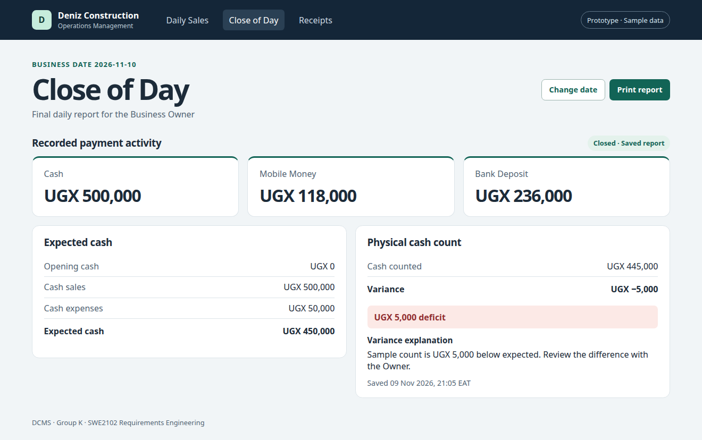

# Grand Project Presentation

Group K · SWE2102 Requirements Engineering · 10 November 2026

## 1. Deniz Construction Management System

Deniz Construction Limited, Mbarara

Group K, SWE2102 Requirements Engineering

Mbarara University of Science and Technology

Speaker 1 | 30 seconds. Introduce the client, a construction materials business that produces blocks, pavers and kerbs. State that this is Group K’s requirements engineering project.

## 2. Group Members

| Name | Registration Number |
|---|---|
| JOAS TAREMWA | 2025/BSE/171/PS |
| ASUMA KADDE KEVIN | 2025/BSE/045/PS |
| SSEBUGWAWO HARRISON | 2025/BSE/161/PS |
| TIBAMANYA DAVIS | 2025/BSE/172/PS |
| EDOU SIMON PETER | 2025/BSE/066/PS |
| MUGENDAWALA MARK PAUL | 2025/BSE/108/PS |
| DAMBYA RACHAEL | 2025/BSE/065/PS |
| OFAMBA JAMES | 2025/BSE/143/PS |
| OSUTA AMEN JOEL | 2025/BSE/152/PS |
| MUSONIRWA IBRAHIM | 2025/BSE/218/PS |

Continue the introduction | 30 seconds. Introduce Group K and move to the problem and scope.

## 3. Problem and project scope

- **One primary operator.** The Sales Manager handles sales, records and cash reconciliation. The Owner reviews the daily report.
- **During the day.** Record sales, update stock and print receipts while customers collect their purchases.
- **At the end of the day.** Record expenses, compare expected cash with the physical count and save the daily report.

Speaker 2 | 2 minutes. Explain why the Sales Manager is the primary user and why the Owner needs a finalized report. Deniz takes payment upfront. The group observed daytime receipting and learned that the Sales Manager uses the laptop to process deficits.

## 4. Stakeholders and elicitation methods

- **Stakeholders.** Sales Manager and Owner. Workers and customers are affected. URA is the external regulator.
- **Direct observation.** We saw the laptop in use and receipts being printed as trucks loaded.
- **Semi-structured interview.** The Sales Manager reported upfront payments by cash, Mobile Money or bank deposit.

Speaker 3 | 1 minute. Distinguish the primary operator, the report audience and the affected stakeholders. The Sales Manager was interviewed during the single site visit. The Owner and workers were unavailable for interviews.
Speaker 4 | 1 minute. Explain what each method contributed. Observation showed the timing of receipting. The interview provided payment rules that were not visible from truck loading alone.

## 5. Group K’s elicitation example

- **Observation.** Receipts were printed while customers’ trucks were being loaded.
- **Limitation.** We could see receipts being printed but could not inspect the fields on them.
- **Design decision.** Print a receipt when the sale is saved. Specify the receipt fields separately.

Speaker 5 | 2 minutes. Explain the difference between timing and content. Seeing a receipt printed supports immediate receipting. It does not establish what the existing receipt contains. We recorded that gap because a follow-up visit was not feasible.

## 6. Key requirements and the offline check

- **Post sales and print receipts.** Give customers a receipt while their truck is being loaded.
- **Log each cash expense.** Account for cash paid out on the selected business date.
- **Reconcile and close the day.** Compare the cash count with expected cash and save the final report for the Owner.
- **Offline resilience (REQ-NFR-PER-01).** Standalone app test. With internet disconnected, post a sale, print its receipt and verify local storage.

Speaker 6 | 1.5 minutes. Explain the three functional examples and the person each helps. Sale entry and printing are REQ-FUN-SAL-01 and REQ-FUN-SAL-04. Expense logging is REQ-FUN-REC-02. Cash variance and closing are REQ-FUN-REC-04 and REQ-FUN-REC-05.
Speaker 7 | 1.5 minutes. Explain why the installed desktop app must handle a sale without internet. The disconnect, save, print and local storage sequence is a planned test for that application.

## 7. Close of Day prototype

Speaker 8 | 1.5 minutes. Point to the business date and the separate recorded activity for Cash, Mobile Money and Bank Deposit. Explain that the three totals belong to the selected date.
Speaker 9 | 1.5 minutes. Walk through the sample from the verification plan. UGX 450,000 expected, UGX 445,000 counted and a UGX 5,000 deficit. A nonzero variance requires an explanation. Reflect on why separating two business dates matters. Closing one day must preserve its report without clearing or mixing activity for another date.

## 8. What we learned

- **Fieldwork shaped the design.** Seeing when receipts were printed showed us when the system needed to record sales.
- **The prototype shows the proposed workflow.** The web prototype demonstrates the workflow. Offline operation and physical printing still need tests on the standalone app.

Speaker 10 | 1 minute. Recap what Group K observed, the requirement it produced and what still needs verification. Invite questions.
